<picture>
  <source media="(prefers-color-scheme: dark)" srcset="./dark.svg">
  <source media="(prefers-color-scheme: light)" srcset="./light.svg">
  
</picture>
👋 Hi, I'm Mohammad Farhan

I'm a Computer Science undergraduate passionate about exploring technology, solving challenging problems, and understanding the systems that power the modern digital world.

My primary interest lies in **Cloud Computing and Distributed Systems**, where I'm particularly fascinated by cloud infrastructure, scalable architectures, and the engineering behind reliable, high-performance computing environments.

I'm currently exploring research-oriented opportunities, strengthening my computer science foundations, and working on projects that turn ideas into practical solutions.

I believe in learning beyond the classroom, questioning how things work, and continuously pushing myself to understand technology at a deeper level.

**Driven by curiosity. Focused on research. Building towards impact.**
